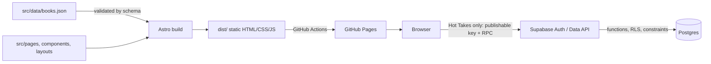

# Architecture

*Last updated: 2026-10-19. Keep this accurate. Update it in the same change that alters the architecture.*

## Overview

Tricky World is a **static Astro site** with one opt-in runtime service. Astro outputs HTML/CSS/JS into `dist/`. Most pages need no backend; Hot Takes uses Supabase Postgres, Auth, and its generated Data API directly from the browser.



A data-engineering analogy: the build is like a dbt run that **materialises** pages from source data. Most browser scripts are dashboard filters over that output. Hot Takes is the exception: its client calls a narrow, governed database function layer at runtime.

## Technology choices

| Concern | Choice | Why (see ADRs) |
|---|---|---|
| Framework | Astro 7, static output | Content-focused, minimal JS by default, can add React later ([ADR-001](DECISIONS.md#adr-001-astro-for-the-initial-website)) |
| Language | TypeScript, `astro/tsconfigs/strict` | Type safety; a learning goal |
| Styling | Plain CSS | No framework needed yet ([ADR-004](DECISIONS.md#adr-004-plain-css-no-ui-framework)) |
| Content | Content collection over one JSON file, Zod 4 schema | Single file to edit, validated at build ([ADR-003](DECISIONS.md#adr-003-repository-based-book-data-in-a-validated-content-collection)) |
| Interactivity | Vanilla TypeScript `<script>`, progressive enhancement | No React until there's a real need ([ADR-005](DECISIONS.md#adr-005-progressive-enhancement-with-vanilla-scripts-before-react)) |
| Hosting | GitHub Pages project site | Free, simple, HTTPS ([ADR-002](DECISIONS.md#adr-002-github-pages-for-static-hosting)) |
| Hot Takes backend | Supabase Postgres + Auth | Persistent user data without moving the whole site to server hosting ([ADR-007](DECISIONS.md#adr-007-supabase-backend-for-hot-takes)) |
| Static type checking | `astro check` | Checks `.astro` templates and browser TypeScript before every build |

## Project structure

```
tricky-world/
├── AGENTS.md                 # Instructions for AI assistants
├── README.md
├── astro.config.mjs          # site/base for GitHub Pages; fail on duplicate content ids
├── package.json              # runtime and development dependencies
├── supabase/                 # Hot Takes migration and local seed data
├── tsconfig.json             # extends astro/tsconfigs/strict
├── public/                   # copied verbatim to dist/ (favicons)
├── docs/                     # mission, architecture, roadmap, ADRs, learning log
└── src/
    ├── content.config.ts     # content collection definitions + schemas
    ├── data/books.json       # book data (source of truth for the library)
    ├── lib/
    │   ├── reading-status.ts # status codes + display labels
    │   ├── strava.ts         # optional build-time Strava totals client
    │   ├── takes.ts          # Supabase auth, loading, submissions and voting
    │   └── url.ts            # url(): prefix paths with the deploy base path
    ├── layouts/BaseLayout.astro  # <head>, header nav, footer
    ├── components/BookCard.astro # one book
    ├── styles/global.css     # design tokens (CSS variables), base styles, dark mode
    └── pages/                # file-based routing
        ├── index.astro       # /
        ├── books.astro       # /books
        ├── takes.astro       # /takes
        └── training.astro    # /training
```

### Key Astro concepts in use

- **File-based routing.** `src/pages/books.astro` becomes `/books/`.
- **Frontmatter runs at build time.** Code between the `---` fences runs in Node during the build, never in the browser.
- **Scoped styles.** A `<style>` in a component only applies to that component.
- **`<script>` tags are processed.** TypeScript in a page's `<script>` is compiled, bundled and shipped to the browser.

## Hot Takes runtime boundary

`/takes` is still static HTML, but its client bundle uses `@supabase/supabase-js` to load live data and manage email magic-link sessions. The public project URL and publishable key are embedded in the browser bundle by design. They identify the Supabase project but do not grant privileged access.

Postgres remains the authorization boundary:

- Base tables (`takes`, `votes`) have RLS enabled and no direct API grants.
- `get_takes()` returns approved text, aggregate counts, and only the current viewer's own choice. It never returns author or voter IDs.
- `submit_take()` and `cast_vote()` require an authenticated JWT and validate their operation in the database.
- `(take_id, user_id)` is the vote primary key, so one active vote per person is a database invariant.
- A trigger forces submissions to `pending`, assigns the authenticated user, trims input, and enforces a ten-minute cooldown.
- Moderation starts in Supabase Studio. A future admin UI can use `moderate_take()`, which checks protected auth app metadata.
- An asynchronous database webhook invokes the `notify-pending-take` Edge Function after inserts. Pending rows produce a Resend email to the moderator; seed/system rows are ignored. A separate webhook secret authenticates the call, and provider credentials remain in Supabase project secrets.

The page includes a static contribution explainer without JavaScript, but the live board cannot progressively render on GitHub Pages without browser JavaScript: there is no request-time server. Setup and verification steps are in [HOT_TAKES_SETUP.md](HOT_TAKES_SETUP.md).

## Base path

The site is a GitHub Pages **project site**, served from `https://patrickebyrne11.github.io/tricky-world/`. `astro.config.mjs` sets:

```js
site: 'https://patrickebyrne11.github.io',
base: '/tricky-world',
```

All internal links and asset references go through `url()` in `src/lib/url.ts`, which prefixes `import.meta.env.BASE_URL`. This also applies locally (`http://localhost:4321/tricky-world/`), so path bugs show up before deploy. Moving to a custom domain or another host means changing `site`/`base` only.

## Book data

Source of truth: `src/data/books.json`, an array of objects. It's loaded with Astro's `file()` loader and validated against the schema in `src/content.config.ts`.

| Field | Type | Required | Rules |
|---|---|---|---|
| `id` | string | yes | Lowercase kebab-case `title-author`, e.g. `project-hail-mary-andy-weir`. Unique. |
| `title` | string | yes | Non-empty |
| `author` | string | yes | Non-empty. Multiple authors: comma-separated (`"David Thomas, Andrew Hunt"`) |
| `status` | enum | yes | `"want-to-read"` \| `"reading"` \| `"read"` |
| `rating` | number | no | 0.5–5 in steps of 0.5 |
| `genres` | string[] | no | Free text, e.g. `["Fiction", "Science Fiction"]` |
| `review` | string | no | Non-empty |
| `yearRead` | integer | no | Year finished, 1900 to the current year; only allowed when `status` is `"read"` |
| `cover` | string | no | Absolute URL |

Display labels for statuses live in `src/lib/reading-status.ts` (codes are stable, labels can change).

### What the build enforces

| Problem | Result |
|---|---|
| Invalid value (bad status, rating 7, year in the future) | Build fails, naming the entry and field |
| Unknown field (e.g. `"raiting"`) | Build fails (`z.strictObject`) |
| Duplicate `id` | Build fails (`prerenderConflictBehavior: 'error'`; Astro's default is only a warning) |
| Entry missing `id` | **Known gap:** Astro logs an error and skips the entry, but the build passes |
| Same book under two different ids | **Known gap:** not detected. Check title + author when adding |

### Workflow for bulk updates

Give an AI assistant a list of books, then have it update `books.json` following the rules above and in [AGENTS.md](../AGENTS.md#book-data-rules) (never invent ratings/statuses/dates; check for duplicates), then run `npm run build`.

## Hosting

GitHub Pages, public repo `patrickebyrne11/tricky-world`. Free, HTTPS by default, supports a custom domain later. Limits: static files only, no server-side code, no request-time secrets.

## Deployment

**Status: live** since 2026-10-17.

- Workflow [`.github/workflows/deploy.yml`](../.github/workflows/deploy.yml), triggered on push to `main`, daily, and manually (`workflow_dispatch`).
- `build` job: `actions/checkout@v7`, refreshes Strava credentials when configured, then `withastro/action@v6` (`npm ci` + `npm run build`, uploads `dist/` as a Pages artifact). A daily schedule refreshes the static Strava snapshot. Token rotation is saved to the `STRAVA_REFRESH_TOKEN` Actions secret using `STRAVA_SECRET_WRITE_TOKEN`.
- `deploy` job (`needs: build`): `actions/deploy-pages@v5` into the `github-pages` environment.
- Least-privilege token permissions: `contents: read`, `pages: write`, `id-token: write` (OIDC, so no long-lived deploy credentials).
- `concurrency: pages` with `cancel-in-progress: false`: deploys queue rather than race.
- Repo setting: Pages build type = **workflow** (GitHub Actions).

Because the build validates book data, a bad data edit fails CI and never reaches the live site. Cost: free (public repo).

## External dependencies

| Dependency | Where | Purpose |
|---|---|---|
| `astro` | runtime/build | Framework (bundles Vite, Zod 4) |
| `@supabase/supabase-js` | browser runtime | Hot Takes auth and Data API client |
| `@astrojs/check`, `typescript` | development/build | Static checking for Astro templates and TypeScript |
| Supabase | Hot Takes runtime service | Postgres, passwordless auth and Data API |
| Resend | Hot Takes notification service | Approval email sent by a Supabase Edge Function |
| Strava API | optional build-time service | Training snapshot refreshed daily ([ADR-006](DECISIONS.md#adr-006-build-time-strava-totals)) |
| GitHub Pages | hosting | Static hosting |
| GitHub Actions | CI/CD | Build + deploy |

No analytics, remote fonts or third-party scripts. The page uses system fonts. The Hot Takes client connects directly to the configured Supabase project.

## Development environment

- Node ≥ 22.22 (`package.json` `engines`), developed on Node 24 / npm 11.
- Two GitHub accounts on the dev machine; this repo uses the **personal** one only (see [AGENTS.md](../AGENTS.md#environment-notes)).
